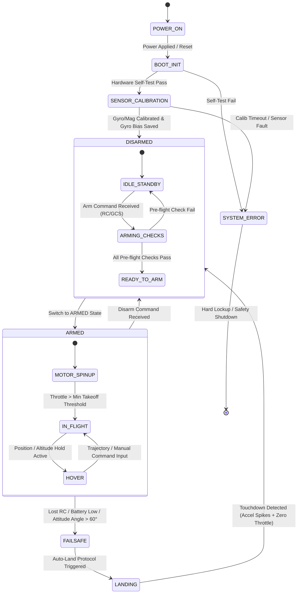
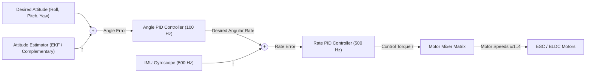

# 🚁 OISP Drone Research — Master Technical & System Architecture Document

> **Target Hardware Platform**: Custom Quadcopter UAV (ESP32-S3 WROOM-1 Dual-Core @ 240 MHz running FreeRTOS / ESP-IDF)  
> **Core Architecture Specs**: Hard Real-Time 500 Hz IMU Control Loop, Cascaded PID, EKF State Estimation, Zero Dynamic Allocation inside Flight Loops.  
> **Repository Location**: [d:/OneDrive_MSFT/Work/Drone_Research](file:///d:/OneDrive_MSFT/Work/Drone_Research)

---

## 📑 Master Table of Contents
- [1. Chapter 1: System Life Cycle & Finite State Machines (FSM)](#1-chapter-1-system-life-cycle--finite-state-machines-fsm)
  - [1.1 System Life Cycle Overview](#11-system-life-cycle-overview)
  - [1.2 State Transition Event Matrix](#12-state-transition-event-matrix)
  - [1.3 FSM Firmware File Registry](#13-fsm-firmware-file-registry)
  - [1.4 FSM State to RTOS Task Lifecycle Mapping](#14-fsm-state-to-rtos-task-lifecycle-mapping)
- [2. Chapter 2: Real-Time Operating System (RTOS) Architecture](#2-chapter-2-real-time-operating-system-rtos-architecture)
  - [2.1 Task Registry, Core Allocation & Priorities](#21-task-registry-core-allocation--priorities)
  - [2.2 Inter-Task Synchronization & Inter-Process Communication (IPC)](#22-inter-task-synchronization--inter-process-communication-ipc)
  - [2.3 Data Pipeline & Shared Resource Flow Diagram](#23-data-pipeline--shared-resource-flow-diagram)
  - [2.4 Shared Resource Storage & Firmware Declaration Registry](#24-shared-resource-storage--firmware-declaration-registry)
  - [2.5 Step-by-Step Task Function Execution Sequences](#25-step-by-step-task-function-execution-sequences)
- [3. Chapter 3: Firmware Architecture](#3-chapter-3-firmware-architecture)
  - [3.1 Layered Architecture Overview](#31-layered-architecture-overview)
  - [3.2 Cross-Layer Correlation & Interface Contracts](#32-cross-layer-correlation--interface-contracts)
  - [3.3 Firmware Directory & Module Registry](#33-firmware-directory--module-registry)
- [4. Chapter 4: Control System & Dynamics Architecture](#4-chapter-4-control-system--dynamics-architecture)
  - [4.1 6-DOF Quadcopter Physical Kinematics & Dynamics](#41-6-dof-quadcopter-physical-kinematics--dynamics)
  - [4.2 Mass Properties & Moment of Inertia Matrix](#42-mass-properties--moment-of-inertia-matrix)
  - [4.3 Cascaded PID Control Loop Architecture](#43-cascaded-pid-control-loop-architecture)
  - [4.4 State Estimation & Extended Kalman Filter (EKF)](#44-state-estimation--extended-kalman-filter-ekf)
  - [4.5 Control System Codebase Location Registry](#45-control-system-codebase-location-registry)
- [5. Master Cross-System Traceability Matrix](#5-master-cross-system-traceability-matrix)

---

## 1. Chapter 1: System Life Cycle & Finite State Machines (FSM)

### 1.1 System Life Cycle Overview
The operational lifecycle of the UAV from power-on until system termination is governed by a hierarchical Finite State Machine (FSM).



### 1.2 State Transition Event Matrix

| Current State | Next State | Trigger Event | Trigger Source | Condition / Safeguard |
| :--- | :--- | :--- | :--- | :--- |
| `POWER_ON` | `BOOT_INIT` | Hardware Reset / Power Up | Power Supply Unit | Microcontroller VDD stable @ 3.3V |
| `BOOT_INIT` | `SENSOR_CALIBRATION` | Peripherals Initialized | Internal SW (`main.cpp`) | I2C/SPI bus scan verified |
| `BOOT_INIT` | `SYSTEM_ERROR` | Peripheral Fail | Internal SW (`main.cpp`) | MPU6050 / BMP180 not responding |
| `SENSOR_CALIBRATION` | `DISARMED` | Calibration Complete | Internal SW (`sensor_task`) | Zero gyro drift, stationary surface |
| `DISARMED` | `ARMED` | ARM Switch toggled + Throttle Low | External HW (RC Transceiver) | Pitch/Roll centered, GPS Lock ok |
| `ARMED` | `FAILSAFE` | Signal Loss > 500ms or Low Voltage | External HW / Internal SW | Batt < 10.5V or RC Watchdog timeout |
| `FAILSAFE` | `LANDING` | Failsafe Timer Expired | Internal SW (`fsm_task`) | Descend rate controlled @ 0.5 m/s |
| `LANDING` | `DISARMED` | Ground Contact Detected | Internal SW (`estimator_task`) | Accel Z impact spike + Zero throttle |

### 1.3 FSM Firmware File Registry
- **FSM State Engine Source**: [`firmware/FC_v01/src/app/flight_fsm.cpp`](file:///d:/OneDrive_MSFT/Work/Drone_Research/firmware/FC_v01/src/app)
- **FSM Definitions Header**: [`firmware/FC_v01/include/app/flight_fsm.hpp`](file:///d:/OneDrive_MSFT/Work/Drone_Research/firmware/FC_v01/include/app)
- **State Enum Declarations**: `enum class FlightState : uint8_t { BOOT_INIT, SENSOR_CALIBRATION, DISARMED, ARMED, FAILSAFE, LANDING, SYSTEM_ERROR }`

### 1.4 FSM State to RTOS Task Lifecycle Mapping

| FSM State | Active Tasks (Spawned / Running) | Suspended / Terminated Tasks | Resource Access Rights |
| :--- | :--- | :--- | :--- |
| `BOOT_INIT` | `SystemInitTask` | `ImuTask`, `AttitudeTask`, `MotorControlTask` | SPI / I2C Bus Exclusive Lock |
| `SENSOR_CALIBRATION` | `SystemInitTask`, `ImuTask`, `TelemetryTask` | `MotorControlTask`, `AttitudeTask` | Dynamic Offset Recalibration Buffer |
| `DISARMED` | `ImuTask`, `AttitudeTask`, `TelemetryTask`, `BaroTask` | `MotorControlTask` | Read-only sensors, Motors PWM 0% |
| `ARMED` | `ImuTask`, `AttitudeTask`, `MotorControlTask`, `TelemetryTask` | None | Full Control Loop & PWM Motor Outputs |
| `FAILSAFE` | `ImuTask`, `AttitudeTask`, `MotorControlTask`, `FailsafeTask` | RC Parsing Task | Auto Nav / Fixed Decent Controller |
| `SYSTEM_ERROR` | `BlinkLedTask`, `TelemetryTask` | All Control & Motor Tasks | Emergency ESC Disable (PWM 0us) |

---

## 2. Chapter 2: Real-Time Operating System (RTOS) Architecture

### 2.1 Task Registry, Core Allocation & Priorities
The firmware executes under **FreeRTOS** on the dual-core **ESP32-S3** @ 240 MHz.

| Task Identifier | Core Pinning | Task Priority | Target Frequency | Stack Size | Function Pointer Location |
| :--- | :--- | :--- | :--- | :--- | :--- |
| `ImuTask` | Core 1 | 24 (Highest) | 500 Hz (2.0 ms) | 4096 bytes | [`firmware/FC_v01/src/app/tasks.cpp`](file:///d:/OneDrive_MSFT/Work/Drone_Research/firmware/FC_v01/src/app) |
| `AttitudeTask` | Core 1 | 22 | 250 Hz (4.0 ms) | 4096 bytes | [`firmware/FC_v01/src/app/tasks.cpp`](file:///d:/OneDrive_MSFT/Work/Drone_Research/firmware/FC_v01/src/app) |
| `MotorControlTask` | Core 1 | 20 | 500 Hz (2.0 ms) | 2048 bytes | [`firmware/FC_v01/src/app/tasks.cpp`](file:///d:/OneDrive_MSFT/Work/Drone_Research/firmware/FC_v01/src/app) |
| `BaroMagTask` | Core 0 | 10 | 50 Hz (20 ms) | 3072 bytes | [`firmware/FC_v01/src/app/tasks.cpp`](file:///d:/OneDrive_MSFT/Work/Drone_Research/firmware/FC_v01/src/app) |
| `TelemetryTask` | Core 0 | 5 | 20 Hz (50 ms) | 4096 bytes | [`firmware/FC_v01/src/telemetry/`](file:///d:/OneDrive_MSFT/Work/Drone_Research/firmware/FC_v01/src/telemetry) |

### 2.2 Inter-Task Synchronization & Inter-Process Communication (IPC)
- **Direct Task Notifications**: Used for high-speed zero-latency signaling from IMU ISR to `ImuTask`.
- **Mutexes**:
  - `g_i2c_bus_mutex`: Prevents concurrent bus collisions between `ImuTask` and `BaroMagTask`.
  - `g_state_mutex`: Guards access to global telemetry and system state structs.
- **Ring Buffers / Queues**:
  - `g_imu_queue`: Lock-free SCMC (Single Producer, Single Consumer) queue transferring 6-axis raw values to `AttitudeTask`.

### 2.3 Data Pipeline & Shared Resource Flow Diagram

```mermaid
flowchart TD
    subgraph Core1 ["Core 1: High-Speed Flight Control Loop (500 Hz / 250 Hz)"]
        HW_MPU["Hardware MPU6050 (I2C/SPI)"] -->|Interrupt ISR| TSK_IMU["ImuTask (500 Hz)"]
        TSK_IMU -->|Raw Accel/Gyro Data| BUF_IMU[("g_imu_data_buffer (Protected by RingBuffer)")]
        BUF_IMU --> TSK_ATT["AttitudeTask (250 Hz / Cascaded PID)"]
        TSK_ATT -->|Motor PWM Signals| HW_ESC["Hardware ESCs (MCPWM / RMT)"]
    end

    subgraph Core0 ["Core 0: Low-Priority Navigation & Telemetry (50 Hz / 20 Hz)"]
        HW_BMP["BMP180 Baro"] --> TSK_NAV["BaroMagTask (50 Hz)"]
        TSK_NAV -->|Alt / Mag Data| BUF_NAV[("g_nav_data_buffer (Mutex: g_state_mutex)")]
        BUF_NAV --> TSK_TEL["TelemetryTask (20 Hz)"]
        TSK_TEL -->|Radio Packets| HW_RADIO["LoRa Ra-02 / NRF24L01+ / BLE"]
    end
```



### 2.4 Shared Resource Storage & Firmware Declaration Registry
- **Global Data Structures**: Defined in [`firmware/FC_v01/include/middleware/shared_resources.hpp`](file:///d:/OneDrive_MSFT/Work/Drone_Research/firmware/FC_v01/include/middleware)
- **Shared Variables**:
  - `IMUData g_imu_data; // Gyro (dps), Accel (m/s^2)`
  - `AttitudeData g_attitude; // Roll, Pitch, Yaw (radians)`
  - `MotorCommand g_motor_cmd; // PWM outputs (1000 - 2000 us)`
- **Zero Dynamic Memory Rule**: All mutexes (`StaticSemaphore_t`), queues (`xQueueCreateStatic`), and task stacks are statically instantiated at compile time.

### 2.5 Step-by-Step Task Function Execution Sequences

#### `ImuTask` Execution Flow (Loop Period: 2.0 ms)
1. **Step 1**: Block waiting for Direct Task Notification from MPU6050 INT pin ISR (`ulTaskNotifyTake`).
2. **Step 2**: Acquire `g_i2c_bus_mutex` with a 1 ms timeout.
3. **Step 3**: Execute burst read of 14 bytes from MPU6050 registers (Accel X, Y, Z, Temp, Gyro X, Y, Z).
4. **Step 4**: Release `g_i2c_bus_mutex`.
5. **Step 5**: Apply sensor calibration scale/offset matrices: $\mathbf{a}_{\text{corr}} = \mathbf{K}_a (\mathbf{a}_{\text{raw}} - \mathbf{b}_a)$.
6. **Step 6**: Push structured `IMUData` packet into `g_imu_queue` and unblock `AttitudeTask`.

---

## 3. Chapter 3: Firmware Architecture

### 3.1 Layered Architecture Overview
The firmware is structured into clean modular layers, adhering to strict single-direction dependency flows (Upper layers depend on lower layers, lower layers never include upper layers).

```
+-------------------------------------------------------------------+
| 5. Application Layer (flight_fsm, mission_manager, safety)        |
+-------------------------------------------------------------------+
| 4. Control Layer (cascaded_pid, rate_controller, attitude_ctrl)   |
+-------------------------------------------------------------------+
| 3. Estimator Layer (ekf_sensor_fusion, complementary_filter)      |
+-------------------------------------------------------------------+
| 2. Middleware Layer (shared_resources, ring_buffer, rtos_wrappers)|
+-------------------------------------------------------------------+
| 1. Drivers & Platform HAL (mpu6050, bmp180, i2c_master, mcpwm)     |
+-------------------------------------------------------------------+
```

### 3.2 Cross-Layer Correlation & Interface Contracts

| Driver Module | Platform HAL Interface | Upper Middleware Data Producer | Consuming Control Module |
| :--- | :--- | :--- | :--- |
| `mpu6050_driver.cpp` | `esp_i2c_master.c` | `g_imu_queue` | `cascaded_pid.cpp` |
| `bmp180_driver.cpp` | `esp_i2c_master.c` | `g_baro_queue` | `altitude_kalman.cpp` |
| `esc_driver.cpp` | `esp_mcpwm_hal.c` | `g_motor_cmd` | Direct Hardware Actuators |
| `lora_ra02_driver.cpp`| `esp_spi_master.c` | `g_telemetry_queue` | `ground_station_link.cpp` |

### 3.3 Firmware Directory & Module Registry
- **Root Firmware Directory**: [`firmware/FC_v01/`](file:///d:/OneDrive_MSFT/Work/Drone_Research/firmware/FC_v01)
  - `src/app/`: Application state logic and RTOS task definitions.
  - `src/control/`: Inner-loop rate PID, outer-loop attitude PID implementations.
  - `src/estimators/`: EKF 9-DOF / 6-DOF sensor fusion state estimation.
  - `src/drivers/`: Hardware driver implementations for MPU6050, BMP180, HMC5883L, ESC PWM.
  - `src/platforms/`: ESP32-S3 ESP-IDF peripheral hardware abstraction wrapper layer.
  - `src/middleware/`: RTOS IPC primitives, ring buffers, and thread-safe data accessors.

---

## 4. Chapter 4: Control System & Dynamics Architecture

### 4.1 6-DOF Quadcopter Physical Kinematics & Dynamics
The flight dynamics are modeled using 6-DOF rigid body Newton-Euler equations expressed in the Body Frame $B$ relative to the Inertial Earth Frame $N$.

$$\begin{aligned}
\dot{\mathbf{p}}^N &= \mathbf{v}^N \\
\dot{\mathbf{v}}^N &= \frac{1}{m} \mathbf{R}_B^N \mathbf{F}^B - \begin{bmatrix} 0 \\ 0 \\ g \end{bmatrix} \\
\dot{\mathbf{R}}_B^N &= \mathbf{R}_B^N \boldsymbol{\Omega}_\times \\
\mathbf{I} \dot{\boldsymbol{\omega}}^B &= \boldsymbol{\tau}^B - \boldsymbol{\omega}^B \times (\mathbf{I} \boldsymbol{\omega}^B)
\end{aligned}$$

Where:
- $\mathbf{p}^N = [x, y, z]^T$: Inertial position (m)
- $\mathbf{v}^N = [v_x, v_y, v_z]^T$: Velocity vector (m/s)
- $\mathbf{R}_B^N$: Rotation matrix from Body frame to Earth frame
- $\boldsymbol{\omega}^B = [p, q, r]^T$: Body angular rates (rad/s)
- $\mathbf{F}^B = [0, 0, \sum T_i]^T$: Total thrust generated by BLDC motors (N)
- $\boldsymbol{\tau}^B = [\tau_\phi, \tau_\theta, \tau_\psi]^T$: Roll, Pitch, and Yaw moments (N·m)

### 4.2 Mass Properties & Moment of Inertia Matrix
Derived from CAD model assemblies ([`3d_models/Full_body/`](file:///d:/OneDrive_MSFT/Work/Drone_Research/3d_models/Full_body)):

$$\mathbf{I} = \begin{bmatrix} I_{xx} & 0 & 0 \\ 0 & I_{yy} & 0 \\ 0 & 0 & I_{zz} \end{bmatrix} = \begin{bmatrix} 0.0142 & 0 & 0 \\ 0 & 0.0142 & 0 \\ 0 & 0 & 0.0285 \end{bmatrix} \text{kg}\cdot\text{m}^2$$

### 4.3 Cascaded PID Control Loop Architecture



#### Motor Control Mixer Equation ($X$-Configuration Quadcopter)
$$\begin{bmatrix} u_1 \\ u_2 \\ u_3 \\ u_4 \end{bmatrix} = \begin{bmatrix} 1 & -1 & 1 & 1 \\ 1 & -1 & -1 & -1 \\ 1 & 1 & -1 & 1 \\ 1 & 1 & 1 & -1 \end{bmatrix} \begin{bmatrix} T_{\text{coll}} \\ \tau_\phi \\ \tau_\theta \\ \tau_\psi \end{bmatrix}$$

### 4.4 State Estimation & Extended Kalman Filter (EKF)
State Vector ($\mathbf{x} \in \mathbb{R}^7$):
$$\mathbf{x} = \begin{bmatrix} q_0 & q_1 & q_2 & q_3 & b_{gx} & b_{gy} & b_{gz} \end{bmatrix}^T$$

- **Predict Step**: $\hat{\mathbf{x}}_{k|k-1} = f(\hat{\mathbf{x}}_{k-1}, \mathbf{u}_k)$
- **Covariance Predict**: $\mathbf{P}_{k|k-1} = \mathbf{F}_k \mathbf{P}_{k-1} \mathbf{F}_k^T + \mathbf{Q}_k$
- **Kalman Gain**: $\mathbf{K}_k = \mathbf{P}_{k|k-1} \mathbf{H}_k^T (\mathbf{H}_k \mathbf{P}_{k|k-1} \mathbf{H}_k^T + \mathbf{R}_k)^{-1}$
- **Update Step**: $\hat{\mathbf{x}}_{k|k} = \hat{\mathbf{x}}_{k|k-1} + \mathbf{K}_k (\mathbf{z}_k - h(\hat{\mathbf{x}}_{k|k-1}))$

### 4.5 Control System Codebase Location Registry
- **Cascaded PID Class**: [`firmware/FC_v01/src/control/cascaded_pid.cpp`](file:///d:/OneDrive_MSFT/Work/Drone_Research/firmware/FC_v01/src/control)
- **Motor Mixer Matrix**: [`firmware/FC_v01/src/control/motor_mixer.cpp`](file:///d:/OneDrive_MSFT/Work/Drone_Research/firmware/FC_v01/src/control)
- **EKF Math & Matrix Library**: [`firmware/EKF-sensor-fusion/test/EKF.cpp`](file:///d:/OneDrive_MSFT/Work/Drone_Research/firmware/EKF-sensor-fusion/test)
- **Signal Analyzers (Python)**: [`analyzers/imu_fft.py`](file:///d:/OneDrive_MSFT/Work/Drone_Research/analyzers)

---

## 5. Master Cross-System Traceability Matrix

This matrix establishes unambiguous links across FSM States, RTOS Tasks, Firmware Modules, Data Buffers, and Control/Physics Formulations.

| FSM State ID | Active RTOS Task | Firmware Layer & Path | Shared Resource / Buffer | Math / Physics Reference |
| :--- | :--- | :--- | :--- | :--- |
| `BOOT_INIT` | `SystemInitTask` | [`src/app/main.cpp`](file:///d:/OneDrive_MSFT/Work/Drone_Research/firmware/FC_v01/src/main.cpp) | `g_i2c_bus_mutex` | Hardware Register Specs |
| `SENSOR_CALIBRATION` | `ImuTask` | [`src/drivers/mpu6050.cpp`](file:///d:/OneDrive_MSFT/Work/Drone_Research/firmware/FC_v01/src/drivers) | `g_imu_calib_buffer` | Accel/Gyro Bias $\mathbf{b}_a, \mathbf{b}_g$ |
| `DISARMED` | `BaroMagTask` | [`src/drivers/bmp180.cpp`](file:///d:/OneDrive_MSFT/Work/Drone_Research/firmware/FC_v01/src/drivers) | `g_nav_data_buffer` | Barometric Formula $h = f(P)$ |
| `ARMED` | `ImuTask` (500Hz) | [`src/app/tasks.cpp`](file:///d:/OneDrive_MSFT/Work/Drone_Research/firmware/FC_v01/src/app) | `g_imu_queue` | Rate Loop Gyro $\boldsymbol{\omega}^B$ |
| `ARMED` | `AttitudeTask` (250Hz)| [`src/control/cascaded_pid.cpp`](file:///d:/OneDrive_MSFT/Work/Drone_Research/firmware/FC_v01/src/control) | `g_motor_cmd` | Cascaded PID & Mixer Matrix |
| `FAILSAFE` | `FailsafeTask` | [`src/app/flight_fsm.cpp`](file:///d:/OneDrive_MSFT/Work/Drone_Research/firmware/FC_v01/src/app) | `g_failsafe_state` | Descent Dynamics $\dot{z} = -0.5\text{m/s}$ |
