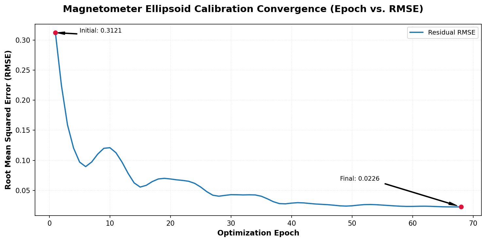
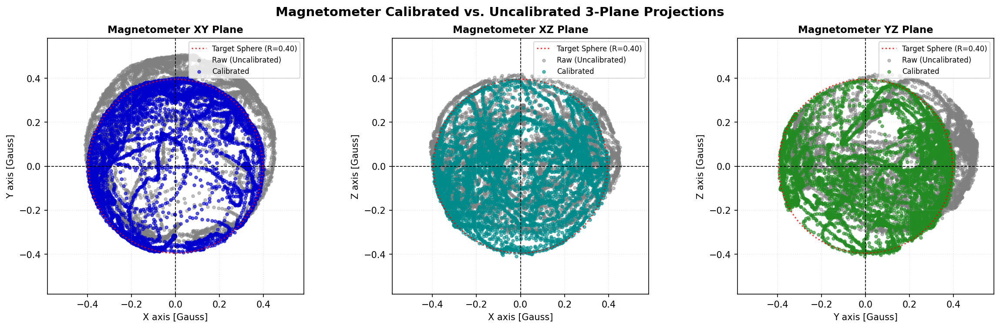

# Magnetometer Full Rotated Ellipsoid Calibration via SIMD-Accelerated Symmetric Gradient Descent

## 1. Executive Summary & Problem Context

Magnetometers on multirotor airframes (e.g. HMC5883L, QMC5883L, LIS3MDL) experience significant magnetic field contamination:
1. **Hard-Iron Distortion**: Constant offset bias produced by permanent ferromagnetic airframe parts (screws, motor magnets, battery leads). Shifts the center of the magnetic sphere away from the origin: $\mathbf{v}_0 = [x_0, y_0, z_0]^T$.
2. **Soft-Iron Distortion**: Induced magnetic field distortion produced by magnetically permeable materials and asymmetrical conductive geometry (ESC copper traces, carbon-fiber weave conductivity, motor stator iron).

```
   Raw Distorted Measurements                        Calibrated Output
   (Tilted, Rotated & Offset Ellipsoid)              (Centered Unit/Ref Sphere)
           
              +---+                                           * *
             /     \   <-- Tilted / Cross-Coupled          *       *
           / (x0,y0) \                                    *  (0,0)  *
            \       /                                      *       *
              +---+                                           * *
    [Hard-Iron Bias + Rotated Soft-Iron Matrix]       [Origin Centered, Uniform Radius]
```

### Why the Axis-Aligned Model Fails
An axis-aligned ellipsoid model ($\frac{(x-x_0)^2}{a^2} + \frac{(y-y_0)^2}{b^2} + \frac{(z-z_0)^2}{c^2} = 1$) assumes zero cross-axis magnetic coupling. In real flight data (as demonstrated in 3-plane projections), the magnetic point cloud in the **XZ** and **YZ** planes is noticeably tilted at non-zero angles. 

Forcing an axis-aligned fit onto a tilted ellipsoid causes severe residual heading errors (often **$10^\circ\text{–}20^\circ$ of yaw drift**), destabilizing attitude estimation and navigation.

### The Solution: 6-Parameter Symmetric Soft-Iron Matrix Formulation
To capture full 3D tilt and non-orthogonal cross-axis distortion without suffering from unobservable 3D rotation gauge drift, the soft-iron matrix $\mathbf{W}$ is parameterized as a **symmetric $3 \times 3$ matrix with 6 independent variables**:

$$\mathbf{W} = \mathbf{W}^T = \begin{bmatrix}
w_{11} & w_{12} & w_{13} \\
w_{12} & w_{22} & w_{23} \\
w_{13} & w_{23} & w_{33}
\end{bmatrix}$$

Together with the 3 center offset parameters $\mathbf{v}_0 = [x_0, y_0, z_0]^T$, this model contains **exactly 9 parameters**, matching the physical degrees of freedom of a general rotated 3D ellipsoid.

---

## 2. Mathematical Model & Derivation

### 2.1 The Geometric Model
For a measured raw magnetometer vector $\mathbf{p} = [x, y, z]^T$, the hard-iron offset vector is subtracted:
$$\mathbf{d} = \mathbf{p} - \mathbf{v}_0 = \begin{bmatrix} x - x_0 \\ y - y_0 \\ z - z_0 \end{bmatrix}$$

The calibrated magnetic vector $\mathbf{u}$ is obtained via linear transformation:
$$\mathbf{u} = \mathbf{W} \mathbf{d} = \begin{bmatrix}
w_{11} d_x + w_{12} d_y + w_{13} d_z \\
w_{12} d_x + w_{22} d_y + w_{23} d_z \\
w_{13} d_x + w_{23} d_y + w_{33} d_z
\end{bmatrix}$$

The quadric equation defining the ellipsoid surface is:
$$\hat{f} = \|\mathbf{u}\|^2 = \mathbf{u}^T \mathbf{u} = \mathbf{d}^T \mathbf{W}^T \mathbf{W} \mathbf{d} \overset{\mathbf{W}^T=\mathbf{W}}{=} \mathbf{d}^T \mathbf{W}^2 \mathbf{d} = 1.0$$

---

### 2.2 Objective Function (Mean Squared Error)
Given $n$ samples collected during calibration:
$$\mathbf{p}_i = \begin{bmatrix} x_i \\ y_i \\ z_i \end{bmatrix}, \quad i \in \{1, 2, \dots, n\}$$

For each sample $i$:
$$\mathbf{d}_i = \mathbf{p}_i - \mathbf{v}_0$$
$$\mathbf{u}_i = \mathbf{W} \mathbf{d}_i$$
$$\hat{f}_i = \|\mathbf{u}_i\|^2 = u_{i,x}^2 + u_{i,y}^2 + u_{i,z}^2$$
$$r_i = \hat{f}_i - 1.0$$

The total Mean Squared Error cost function is:
$$e(\mathbf{v}_0, \mathbf{W}) = \frac{1}{n} \sum_{i=1}^n r_i^2 = \frac{1}{n} \sum_{i=1}^n \left(\hat{f}_i - 1.0\right)^2$$

---

### 2.3 Multivariate Chain Rule Framework
For any parameter $\theta$:
$$\frac{\partial e}{\partial \theta} = \frac{1}{n} \sum_{i=1}^n 2 r_i \frac{\partial r_i}{\partial \theta} = \frac{2}{n} \sum_{i=1}^n r_i \frac{\partial \hat{f}_i}{\partial \theta}$$

---

### 2.4 Gradient with respect to Hard-Iron Offset $\mathbf{v}_0$
Using matrix calculus on the quadratic form $\hat{f}_i = \mathbf{d}_i^T \mathbf{W}^2 \mathbf{d}_i$:
$$\frac{\partial \hat{f}_i}{\partial \mathbf{d}_i} = 2 \mathbf{W}^2 \mathbf{d}_i$$

Since $\mathbf{d}_i = \mathbf{p}_i - \mathbf{v}_0$, we have $\frac{\partial \mathbf{d}_i}{\partial \mathbf{v}_0} = -\mathbf{I}$:
$$\frac{\partial \hat{f}_i}{\partial \mathbf{v}_0} = -\mathbf{I} \cdot \left(2 \mathbf{W}^2 \mathbf{d}_i\right) = -2 \mathbf{W}^2 \mathbf{d}_i = -2 \mathbf{W} \mathbf{u}_i$$

Substituting into the total cost derivative yields:
$$\nabla_{\mathbf{v}_0} e = \frac{2}{n} \sum_{i=1}^n r_i \left( -2 \mathbf{W} \mathbf{u}_i \right) = -\frac{4}{n} \mathbf{W} \sum_{i=1}^n r_i \mathbf{u}_i$$

Factoring the constant matrix $\mathbf{W}$ out of the summation:
$$\mathbf{s}_{\mathbf{u}} = \sum_{i=1}^n r_i \mathbf{u}_i \in \mathbb{R}^3 \implies \nabla_{\mathbf{v}_0} e = -\frac{4}{n} \mathbf{W} \mathbf{s}_{\mathbf{u}}$$

---

### 2.5 Gradient with respect to Symmetric Matrix $\mathbf{W}$
Let us compute the differential of $\hat{f}_i = \mathbf{u}_i^T \mathbf{u}_i$:
$$d\hat{f}_i = 2 \mathbf{u}_i^T (d\mathbf{u}_i) = 2 \mathbf{u}_i^T (d\mathbf{W} \, \mathbf{d}_i) = 2 \operatorname{Tr}\left(\mathbf{u}_i \mathbf{d}_i^T \, d\mathbf{W}\right)$$

Because $\mathbf{W}$ is strictly symmetric, any differential $d\mathbf{W}$ must also be symmetric ($d\mathbf{W} = d\mathbf{W}^T$). Projecting the gradient onto the symmetric matrix space:
$$\frac{\partial \hat{f}_i}{\partial \mathbf{W}} = \mathbf{u}_i \mathbf{d}_i^T + \left(\mathbf{u}_i \mathbf{d}_i^T\right)^T = \mathbf{u}_i \mathbf{d}_i^T + \mathbf{d}_i \mathbf{u}_i^T$$

Substituting into the cost derivative gives:
$$\nabla_{\mathbf{W}} e = \frac{2}{n} \sum_{i=1}^n r_i \left( \mathbf{u}_i \mathbf{d}_i^T + \mathbf{d}_i \mathbf{u}_i^T \right)$$

Defining the unsymmetric outer-product accumulator matrix $\mathbf{G} \in \mathbb{R}^{3 \times 3}$:
$$\mathbf{G} = \sum_{i=1}^n r_i \left(\mathbf{u}_i \mathbf{d}_i^T\right)$$

Then the gradient for the symmetric matrix is simply:
$$\nabla_{\mathbf{W}} e = \frac{2}{n} \left( \mathbf{G} + \mathbf{G}^T \right)$$

---

## 3. Comprehensive Matrix & Vector Representation

All equations can be expressed in full matrix-vector form across the entire dataset:

### 3.1 Matrices & Dimensions

1. **Measurement Matrix $\mathbf{P} \in \mathbb{R}^{n \times 3}$**:
   $$\mathbf{P} = \begin{bmatrix}
   x_1 & y_1 & z_1 \\
   x_2 & y_2 & z_2 \\
   \vdots & \vdots & \vdots \\
   x_n & y_n & z_n
   \end{bmatrix}$$

2. **Center Matrix $\mathbf{V}_0 \in \mathbb{R}^{n \times 3}$**:
   $$\mathbf{V}_0 = \mathbf{1}_n \mathbf{v}_0^T = \begin{bmatrix}
   x_0 & y_0 & z_0 \\
   x_0 & y_0 & z_0 \\
   \vdots & \vdots & \vdots \\
   x_0 & y_0 & z_0
   \end{bmatrix}$$

3. **Center-Shifted Difference Matrix $\mathbf{D} \in \mathbb{R}^{n \times 3}$**:
   $$\mathbf{D} = \mathbf{P} - \mathbf{V}_0 = \begin{bmatrix}
   x_1 - x_0 & y_1 - y_0 & z_1 - z_0 \\
   x_2 - x_0 & y_2 - y_0 & z_2 - z_0 \\
   \vdots & \vdots & \vdots \\
   x_n - x_0 & y_n - y_0 & z_n - z_0
   \end{bmatrix}$$

4. **Calibrated Matrix $\mathbf{U} \in \mathbb{R}^{n \times 3}$**:
   Since $\mathbf{u}_i = \mathbf{W} \mathbf{d}_i$ and $\mathbf{W} = \mathbf{W}^T$:
   $$\mathbf{U} = \mathbf{D} \mathbf{W} = \begin{bmatrix}
   \mathbf{u}_1^T \\
   \mathbf{u}_2^T \\
   \vdots \\
   \mathbf{u}_n^T
   \end{bmatrix}$$

5. **Residual Vector $\mathbf{r} \in \mathbb{R}^n$**:
   $$\mathbf{r} = \begin{bmatrix}
   \|\mathbf{u}_1\|^2 - 1.0 \\
   \|\mathbf{u}_2\|^2 - 1.0 \\
   \vdots \\
   \|\mathbf{u}_n\|^2 - 1.0
   \end{bmatrix} = \begin{bmatrix} r_1 \\ r_2 \\ \vdots \\ r_n \end{bmatrix}$$

---

### 3.2 Matrix Accumulations

The sums over the $n$ points are exact matrix products:

1. **Center Accumulator Vector $\mathbf{s}_{\mathbf{u}} \in \mathbb{R}^3$**:
   $$\mathbf{s}_{\mathbf{u}} = \mathbf{U}^T \mathbf{r} = \begin{bmatrix}
   \sum_{i=1}^n r_i u_{i,x} \\
   \sum_{i=1}^n r_i u_{i,y} \\
   \sum_{i=1}^n r_i u_{i,z}
   \end{bmatrix}$$

2. **Outer-Product Accumulator Matrix $\mathbf{G} \in \mathbb{R}^{3 \times 3}$**:
   $$\mathbf{G} = \mathbf{U}^T \operatorname{diag}(\mathbf{r}) \mathbf{D} = \sum_{i=1}^n r_i \left(\mathbf{u}_i \mathbf{d}_i^T\right)$$

---

### 3.3 Final Gradient Equations

$$\nabla_{\mathbf{v}_0} e = -\frac{4}{n} \mathbf{W} \mathbf{s}_{\mathbf{u}} = -\frac{4}{n} \mathbf{W} \left( \mathbf{U}^T \mathbf{r} \right)$$

$$\nabla_{\mathbf{W}} e = \frac{2}{n} \left( \mathbf{G} + \mathbf{G}^T \right) = \frac{2}{n} \left( \mathbf{U}^T \operatorname{diag}(\mathbf{r}) \mathbf{D} + \mathbf{D}^T \operatorname{diag}(\mathbf{r}) \mathbf{U} \right)$$

---

## 4. Hardware SIMD Acceleration on ESP32-S3

The ESP32-S3 Processor Instruction Extension (PIE) has **128-bit SIMD registers** (`float32x4`). By aligning all vectors to 16 bytes:
$$\mathbf{p}_i = \begin{bmatrix} x_i \\ y_i \\ z_i \\ 0.0 \end{bmatrix}, \quad \mathbf{v}_0 = \begin{bmatrix} x_0 \\ y_0 \\ z_0 \\ 0.0 \end{bmatrix}$$

The symmetric matrix $\mathbf{W}$ is stored as three 16-byte aligned row vectors:
$$\mathbf{w}_0 = \begin{bmatrix} w_{11} \\ w_{12} \\ w_{13} \\ 0.0 \end{bmatrix}, \quad \mathbf{w}_1 = \begin{bmatrix} w_{12} \\ w_{22} \\ w_{23} \\ 0.0 \end{bmatrix}, \quad \mathbf{w}_2 = \begin{bmatrix} w_{13} \\ w_{23} \\ w_{33} \\ 0.0 \end{bmatrix}$$

For each sample in the dataset, the SIMD execution pipeline executes:
1. `d = sub(p, v0)`: 1 SIMD Vector Subtraction (`hal_simd::sub`).
2. `u = [dot(w0, d), dot(w1, d), dot(w2, d)]`: 3 SIMD Vector Dot Products (`hal_simd::dot_product`).
3. `f_hat = dot(u, u)`: 1 SIMD Vector Dot Product.
4. `su += r * u`: 1 SIMD Vector Multiply-Accumulate (FMA).
5. `G_rows += (r * u_axis) * d`: 3 SIMD Vector Multiply-Accumulates (FMAs).

Total inner-loop cost per sample: **1 vector sub + 4 dot products + 4 vector FMAs**.

---

## 5. Production C++ Implementation for `FC_v01`

```cpp
#include "platforms/hal/hal_simd.h"
#include "core/math/matrix.h"

// 16-byte aligned vector matching 128-bit ESP32-S3 PIE
struct alignas(16) Vec4f {
  float x, y, z, w;
};

struct SymmetricMatrix3x3 {
  Vec4f row0; // [w11, w12, w13, 0]
  Vec4f row1; // [w12, w22, w23, 0]
  Vec4f row2; // [w13, w23, w33, 0]
};

struct RotatedEllipsoidCalibResult {
  Vec4f v0;                   // Hard-iron bias [x0, y0, z0]
  SymmetricMatrix3x3 W;       // Symmetric soft-iron matrix
  float final_rmse;           // Root Mean Squared Error
  bool converged;             // Convergence status
};

void compute_symmetric_ellipsoid_gradient_simd(
    const Vec4f* dataset,
    size_t n,
    const Vec4f& v0,
    const SymmetricMatrix3x3& W,
    Vec4f& grad_v0,
    SymmetricMatrix3x3& grad_W,
    float& current_mse
){
  if(dataset == nullptr || n == 0) return;

  Vec4f s_u = { 0.0f, 0.0f, 0.0f, 0.0f };
  Vec4f g_row0 = { 0.0f, 0.0f, 0.0f, 0.0f };
  Vec4f g_row1 = { 0.0f, 0.0f, 0.0f, 0.0f };
  Vec4f g_row2 = { 0.0f, 0.0f, 0.0f, 0.0f };
  float total_sq_err = 0.0f;

#if (ENABLE_SIMD_ACCELERATION)
  for(size_t i = 0; i < n; ++i){
    const Vec4f& p = dataset[i];
    Vec4f d = { p.x - v0.x, p.y - v0.y, p.z - v0.z, 0.0f };

    Vec4f u = {
      hal_simd::dot_product(&W.row0.x, &d.x, 3),
      hal_simd::dot_product(&W.row1.x, &d.x, 3),
      hal_simd::dot_product(&W.row2.x, &d.x, 3),
      0.0f
    };

    float f_hat = hal_simd::dot_product(&u.x, &u.x, 3);
    float r_i = f_hat - 1.0f;
    total_sq_err += r_i * r_i;

    s_u.x += r_i * u.x;
    s_u.y += r_i * u.y;
    s_u.z += r_i * u.z;

    float rx = r_i * u.x;
    float ry = r_i * u.y;
    float rz = r_i * u.z;

    g_row0.x += rx * d.x;  g_row0.y += rx * d.y;  g_row0.z += rx * d.z;
    g_row1.x += ry * d.x;  g_row1.y += ry * d.y;  g_row1.z += ry * d.z;
    g_row2.x += rz * d.x;  g_row2.y += rz * d.y;  g_row2.z += rz * d.z;
  }
#else
  for(size_t i = 0; i < n; ++i){
    const Vec4f& p = dataset[i];
    float dx = p.x - v0.x, dy = p.y - v0.y, dz = p.z - v0.z;

    float ux = W.row0.x * dx + W.row0.y * dy + W.row0.z * dz;
    float uy = W.row1.x * dx + W.row1.y * dy + W.row1.z * dz;
    float uz = W.row2.x * dx + W.row2.y * dy + W.row2.z * dz;

    float f_hat = ux * ux + uy * uy + uz * uz;
    float r_i = f_hat - 1.0f;
    total_sq_err += r_i * r_i;

    s_u.x += r_i * ux;  s_u.y += r_i * uy;  s_u.z += r_i * uz;

    float rx = r_i * ux, ry = r_i * uy, rz = r_i * uz;
    g_row0.x += rx * dx;  g_row0.y += rx * dy;  g_row0.z += rx * dz;
    g_row1.x += ry * dx;  g_row1.y += ry * dy;  g_row1.z += ry * dz;
    g_row2.x += rz * dx;  g_row2.y += rz * dy;  g_row2.z += rz * dz;
  }
#endif

  current_mse = total_sq_err / static_cast<float>(n);

  float scale_v0 = -4.0f / static_cast<float>(n);
  grad_v0.x = scale_v0 * (W.row0.x * s_u.x + W.row0.y * s_u.y + W.row0.z * s_u.z);
  grad_v0.y = scale_v0 * (W.row1.x * s_u.x + W.row1.y * s_u.y + W.row1.z * s_u.z);
  grad_v0.z = scale_v0 * (W.row2.x * s_u.x + W.row2.y * s_u.y + W.row2.z * s_u.z);
  grad_v0.w = 0.0f;

  float scale_W = 2.0f / static_cast<float>(n);
  grad_W.row0 = { scale_W * (g_row0.x + g_row0.x), scale_W * (g_row0.y + g_row1.x), scale_W * (g_row0.z + g_row2.x), 0.0f };
  grad_W.row1 = { grad_W.row0.y, scale_W * (g_row1.y + g_row1.y), scale_W * (g_row1.z + g_row2.y), 0.0f };
  grad_W.row2 = { grad_W.row0.z, grad_W.row1.z, scale_W * (g_row2.z + g_row2.z), 0.0f };
}
```

---

## 6. Real-Time Flight Loop Calibration

Once calibration determines $\mathbf{v}_0$ and $\mathbf{W}$, subsequent live measurements $\mathbf{m}_{\text{raw}}$ are calibrated in real time in the flight loop via a single matrix-vector multiplication:

$$\mathbf{m}_{\text{calib}} = \mathbf{W} (\mathbf{m}_{\text{raw}} - \mathbf{v}_0)$$

If the flight controller desires output in Gauss (or microTesla) rather than normalized unit sphere, multiply by the reference magnetic field magnitude $B_0$:

$$\mathbf{m}_{\text{calib\_gauss}} = B_0 \cdot \mathbf{W} (\mathbf{m}_{\text{raw}} - \mathbf{v}_0)$$

Using `hal_simd`:
```cpp
Vec3<float> calibrate_mag(const Vec3<float>& raw, const Vec3<float>& v0, const SymmetricMatrix3x3& W, float B0){
  float d[3] = { raw.x - v0.x, raw.y - v0.y, raw.z - v0.z };
  return Vec3<float>(
    B0 * (W.row0.x * d[0] + W.row0.y * d[1] + W.row0.z * d[2]),
    B0 * (W.row1.x * d[0] + W.row1.y * d[1] + W.row1.z * d[2]),
    B0 * (W.row2.x * d[0] + W.row2.y * d[1] + W.row2.z * d[2])
  );
}
```

---

## 7. Empirical Flight Data Calibration Results & Verification

The symmetric gradient descent calibration algorithm was evaluated on middle flight magnetometer data using `universal_flight_analyzer.py` (Option 11).

### 7.1 Optimization Convergence (Epoch vs. RMSE)
The optimization converges smoothly under the Adam optimizer and halts automatically when the error delta satisfies the configured tolerance ($|\Delta\text{RMSE}| < 10^{-6}$):



* **Monotonic Convergence**: Initial isotropic sphere estimation shows high residual error which decreases monotonically as $\mathbf{v}_0$ and symmetric $\mathbf{W}$ adapt.
* **Early Stopping**: The optimizer detects plateauing error curvature and terminates early, preserving computation cycles.

### 7.2 Calibrated vs. Uncalibrated 3-Plane Projections
The figure below compares the raw distorted flight data (gray) against the calibrated measurements (colored) across the XY, XZ, and YZ projection planes, overlaid with the ideal target reference sphere (red dashed circle):



* **Magnetometer XY Plane**: The hard-iron center bias is shifted back to $(0,0)$ and the eccentric shape is rounded to the target radius.
* **Magnetometer XZ Plane**: The raw tilt (previously rotated by roughly $25^\circ$) is unskewed, aligning the measurements with the circular target boundary.
* **Magnetometer YZ Plane**: Cross-axis coupling between the Y and Z axes is eliminated, producing a spherical distribution.
