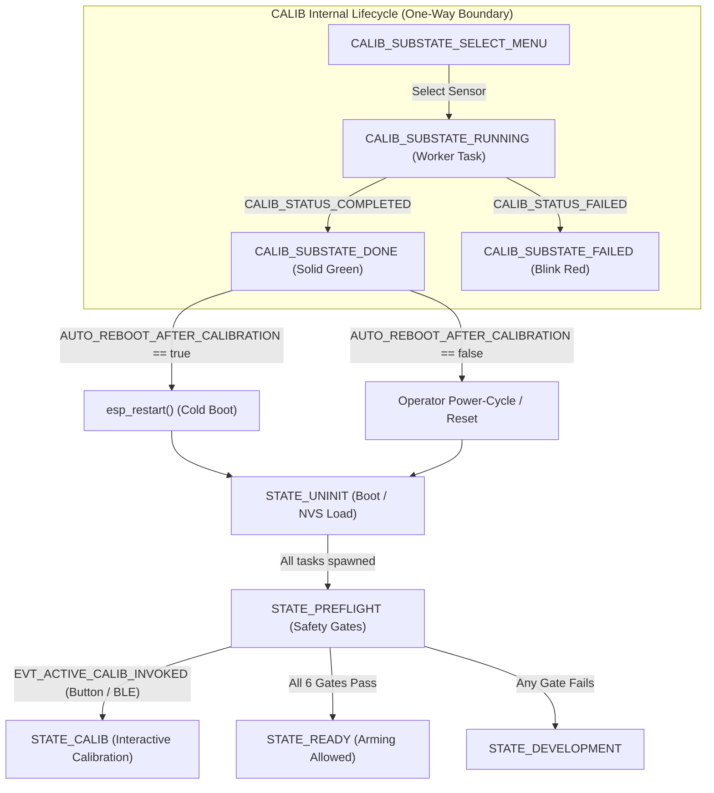

# Zettel 0040: FSM Calibration Terminal State & Mandatory Reboot Boundary Architectural Decision

## 1. Metadata & Scope
- **ID**: `0040`
- **Author**: Drone Research Team / Developer
- **Date**: 2026-10-27
- **Time**: 22:33:00 +07:00
- **Status**: Approved & Enforced Architectural Decision
- **Module Context**: Layer 5 Application Domain (`src/app/fsm.cpp`), Layer 4 Calibration Tasks (`src/core/sensor/calib_tasks.cpp`), Flash Storage Driver (`src/drivers/storage/flash_storage_driver.cpp`)

---

## 2. Context & Problem Statement
In previous revisions of the FSM transition table (`src/app/fsm.cpp`), an exploratory transition rule `Rule_Calib_To_Preflight` existed:
```cpp
// Legacy rule (CALIB -> PREFLIGHT)
{
  CALIB,
  PREFLIGHT,
  EVT_CALIB_COMPLETE,
  EVT_NONE,
  MatchPolicy::ANY,
  EVT_EMERGENCY_SHUTDOWN | EVT_CALIB_FAILED,
  MatchPolicy::ANY,
  "Rule_Calib_To_Preflight"
}
```
However, in runtime operation, `handle_state_calib()` intentionally remained inside `CALIB_SUBSTATE_DONE` upon calibration completion (`CALIB_STATUS_COMPLETED`), leading to a static audit observation that `Rule_Calib_To_Preflight` was dead code.

This design decision clarifies why transitioning directly from `STATE_CALIB` back to `STATE_PREFLIGHT` (or active operational states) without an intermediate cold system reboot is **strictly forbidden**.

---

## 3. Core Architectural Decision: The Calibration Reboot Boundary

### 3.1 Contamination of Preprocessing & Estimator State
Active calibration tasks (`task_calib_gyro`, `task_calib_baro`, `task_calib_accel`, `task_calib_mag`) compute zero-rate biases, ground pressure reference, and 3D ellipsoid compensation matrices (hard-iron offset vector and soft-iron rotation/scaling matrix). These parameters are committed directly to non-volatile storage (`calib_save_to_nvs()`).

If the firmware were allowed to transition directly back into `STATE_PREFLIGHT` while tasks are continuously executing:
1. **Filter Memory Contamination**: The 1st-order and 2nd-order discrete IIR low-pass filter states in `src/core/sensor/sensor_preprocess_tasks.cpp` (`s_lpf_accel_*`, `s_lpf_gyro_*`, `s_lpf_mag_*`) hold prior internal filter histories derived from uncalibrated or old-bias measurements.
2. **Ring Buffer Desynchronization**: Lock-free static ring buffers (`accel_raw`, `gyro_raw`, `mag_raw`, `pressure`) in `src/middleware/ipc.h` contain pre-calibration samples that would be ingested alongside post-calibration samples by downstream consumers.
3. **EKF Covariance Disruption**: State estimators (`AttitudeEKFEngine`, `AltitudeEKFEngine`) would experience sudden discontinuous step changes in normalized sensor vectors, potentially destabilizing quaternion covariance matrices $P_{k|k}$.

### 3.2 Terminal Calibration State Enforcement
Consequently, `STATE_CALIB` is explicitly architected as a **one-way terminal maintenance state**:
- `Rule_Calib_To_Preflight` is formally excised from `s_transition_rules[]`.
- No transition rule exists from `CALIB` back to `PREFLIGHT`, `READY`, or `DEVELOPMENT`.
- When calibration completes (`CALIB_SUBSTATE_DONE`):
  - If `AUTO_REBOOT_AFTER_CALIBRATION` is enabled in `include/config.h`, the system delays 2.0 seconds and triggers `esp_restart()`.
  - If `AUTO_REBOOT_AFTER_CALIBRATION` is disabled, the system intentionally idles in `CALIB_SUBSTATE_DONE` with a solid green LED status indicator until the operator physically power-cycles or resets the flight controller.
- When calibration fails (`CALIB_SUBSTATE_FAILED`), the system holds with a fast-blinking red LED error indicator until rebooted.

---

## 4. State Lifecycle Diagram



---

## 5. Architectural Invariants
1. **No Runtime In-Flight Calibration Transitions**: Under zero circumstances may `fsm.cpp` transition from `CALIB` directly into an operational flight or pre-flight state.
2. **Cold Boot Requirement**: Sensor calibration parameters persisted in NVS flash must only be loaded during clean system startup (`UNINIT -> PREFLIGHT`), guaranteeing pristine IIR filter initialization and empty ring buffers.
