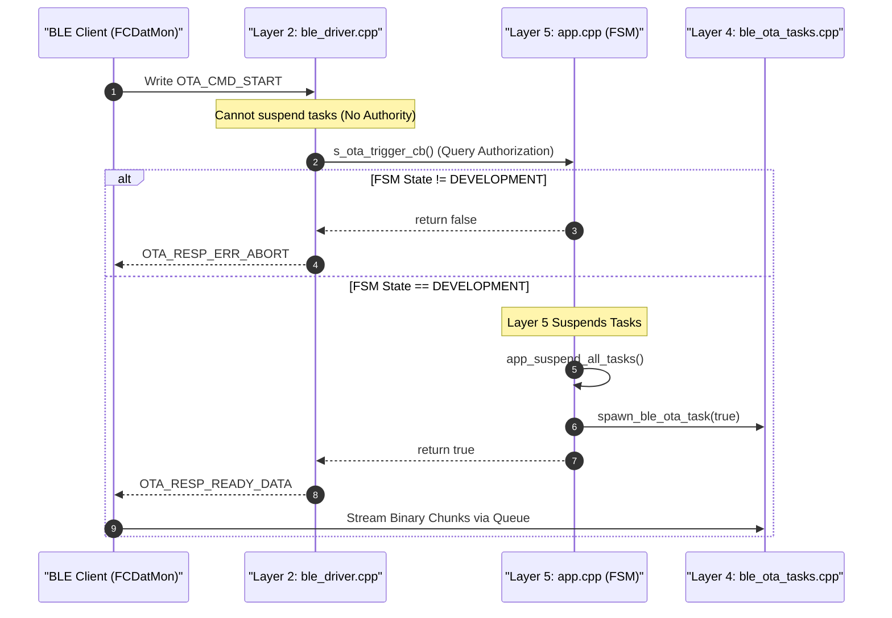

# Zettel 0042: Layer 5 Exclusive Task Suspension Authority & Layer 4 OTA Decoupling Architecture

## 1. Metadata & Scope
- **ID**: `0042`
- **Author**: Drone Research Team / Developer
- **Date**: 2026-10-28
- **Time**: 22:53:00 +07:00
- **Status**: Approved & Enforced Architectural Decision
- **Module Context**: Layer 5 Application Domain (`src/app/app.cpp`, `src/app/fsm.cpp`), Layer 4 Telemetry (`src/core/telemetry/ble_ota_tasks.cpp`), Layer 2 BLE Driver (`src/drivers/telemetry/ble_driver.cpp`)

---

## 2. Problem Statement & Authority Inversion Violation
Under previous revisions, `ble_ota_tasks.cpp` (Layer 4) directly imported `app/app.h` and executed `app_suspend_all_tasks()` when an OTA payload was detected. This introduced two severe architectural violations:

1. **Upward Dependency Violation (Layer 4 $\rightarrow$ Layer 5)**:
   Layer 4 contains domain flight algorithms and worker tasks. Per `[Note 0000]`, Layer 4 must strictly depend downward on Layers 1–3 and never import Layer 5 (`src/app/app.h`).
2. **Usurpation of System Authority**:
   Suspending the entire suite of flight control, sensor DAQ, and motor output tasks (`app_suspend_all_tasks()`) is a global lifecycle operation. A background telemetry worker task must **never** possess the authority to unilaterally halt flight controller operations. Authority over task execution states belongs exclusively to **Layer 5** (Application coordinator / FSM).

---

## 3. Core Architectural Decision: Layer 5 Exclusive Lifecycle Authority

### 3.1 Principle of Exclusive Layer 5 Authority
- **No Worker Task May Suspend the System**: Under zero circumstances may any Layer 4 task (`ble_ota_task`, `sd_logger_task`, etc.) call `app_suspend_all_tasks()` or `vTaskSuspend()` on foreign task handles.
- **Layer 5 Sole Authority**: Only Layer 5 instances (`src/app/app.cpp` and `src/app/fsm.cpp`) hold the authority to inspect global FSM state, evaluate flight readiness, and orchestrate task suspension.

### 3.2 Authorization & Suspension Gating Pattern
1. When an incoming OTA request (`OTA_CMD_START`) arrives in the BLE driver (`src/drivers/telemetry/ble_driver.cpp`), it does **not** wake the OTA task directly.
2. The BLE driver invokes the dependency-injected authorization callback `s_ota_trigger_cb()`, which points to `on_ble_ota_requested()` in **Layer 5 (`src/app/app.cpp`)**.
3. **Layer 5 evaluates safety & executes suspension**:
   ```cpp
   // src/app/app.cpp (Layer 5)
   static bool on_ble_ota_requested(){
     // 1. Gated strictly to safe DEVELOPMENT mode (motors disarmed)
     if(fsm_get_state() != DEVELOPMENT) return false;

     // 2. Layer 5 exercises its authority to halt all operational tasks
     Serial.println("[APP] Layer 5: Authorizing OTA update and suspending all background tasks...");
     app_suspend_all_tasks();

     // 3. Spawns or signals the OTA worker task
     return spawn_ble_ota_task(true);
   }
   ```
4. **Layer 4 Worker Purity**:
   `src/core/telemetry/ble_ota_tasks.cpp` removes `#include "app/app.h"` completely. It acts purely as a passive partition writer and binary receiver, knowing nothing about higher-layer system tasks.

---

## 4. Architectural Sequence Flow



---

## 5. Architectural Invariants
1. `src/core/telemetry/ble_ota_tasks.cpp` must never `#include "app/app.h"`.
2. All global task suspensions prior to flash rewriting must be executed inside Layer 5 prior to worker task activation.
