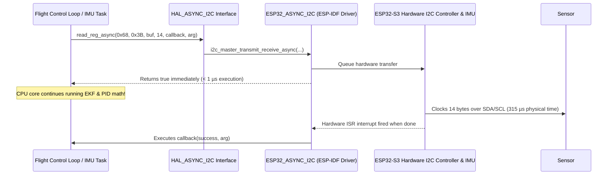

# Implementation Plan: Asynchronous Non-Blocking I2C HAL (`HAL_ASYNC_I2C`)

## Overview & Technical Motivation

In hard real-time flight controllers running high-frequency control loops (500Hz – 8kHz), blocking standard I2C reads spend ~315 µs (75,600 CPU clock cycles on a 240MHz ESP32-S3) waiting for physical wire pulses. 

The `HAL_ASYNC_I2C` abstraction decouples CPU clock execution from physical bus timing. It initiates I2C transactions non-blockingly ($<1\ \mu s$) and uses hardware interrupts (ISRs) and FreeRTOS callbacks/task notifications to alert the control loop when data transfer completes.

---

## User Review Required

> [!IMPORTANT]
> **ESP-IDF `i2c_master` Driver Dependency**:
> Asynchronous I2C transfers cannot be achieved through Arduino's `Wire.h` (which is inherently synchronous). `ESP32_ASYNC_I2C` will use ESP-IDF's native hardware driver (`driver/i2c_master.h`), which is fully supported under PlatformIO's `framework = arduino, espidf` setup.

> [!NOTE]
> **Callback Safety**: Asynchronous callbacks fire from Interrupt Service Routine (ISR) context or low-level driver tasks. Callbacks must be fast, non-blocking, and use `FromISR` FreeRTOS APIs if signaling tasks.

---

## Proposed File Changes

### 1. Abstract HAL Interface
#### [NEW] [hal_async_i2c.h](file:///D:/OneDrive_MSFT/Work/Drone_Research/firmware/FC_v01/src/platforms/hal/hal_async_i2c.h)
Defines the hardware-agnostic asynchronous I2C interface contract:
* Callback definition: `typedef void (*i2c_async_callback_t)(bool success, void* user_arg);`
* `read_reg_async(...)`: Non-blocking multi-byte read request.
* `write_reg_async(...)`: Non-blocking multi-byte write request.
* `wait_sync(...)`: Helper to block synchronously during sensor initialization steps.

### 2. ESP32-S3 Target Implementation
#### [NEW] [esp32_async_i2c.h](file:///D:/OneDrive_MSFT/Work/Drone_Research/firmware/FC_v01/src/platforms/targets/espressif/esp32_async_i2c.h)
#### [NEW] [esp32_async_i2c.cpp](file:///D:/OneDrive_MSFT/Work/Drone_Research/firmware/FC_v01/src/platforms/targets/espressif/esp32_async_i2c.cpp)
* Wraps ESP-IDF's `driver/i2c_master.h` driver (`i2c_master_bus_handle_t` & `i2c_master_dev_handle_t`).
* Configures interrupt-driven asynchronous transfers (`i2c_master_transmit_receive_async()`).
* Fires the user-provided callback upon hardware ISR completion event (`I2C_MASTER_EVENT_DONE`).

---

## Data Flow Diagram

---

## Step-by-Step Implementation Roadmap

### Phase 1: Define `hal_async_i2c.h` Interface
* Create `src/platforms/hal/hal_async_i2c.h` adhering to the project's 2-space indentation style.

### Phase 2: Implement `esp32_async_i2c.h` and `esp32_async_i2c.cpp`
* Include ESP-IDF headers `<driver/i2c_master.h>`.
* Implement bus initialization (`i2c_new_master_bus`) and device registration (`i2c_master_bus_add_device`).
* Implement non-blocking transfers using `i2c_master_transmit_receive_async()`.

### Phase 3: Build Verification & Unit Test
* Add a test application step in `src/main.cpp` to initiate asynchronous reads from an IMU register and measure non-blocking CPU execution time using `esp_timer_get_time()`.

---

## Verification Plan

### Automated Build Verification
1. Run `pio run` in `firmware/FC_v01` to confirm clean compilation of the new `HAL_ASYNC_I2C` classes.

### Execution Verification
1. Measure execution time of `read_reg_async()` call using microsecond timer:
   $$\text{Expected Execution Time} < 5 \ \mu s$$ (compared to $315 \ \mu s$ for synchronous `Wire.h`).
2. Verify callback receives `success == true` and valid IMU register bytes.
